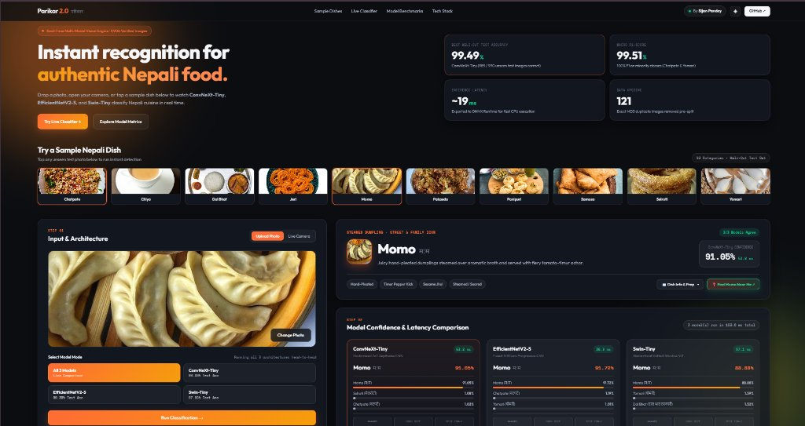
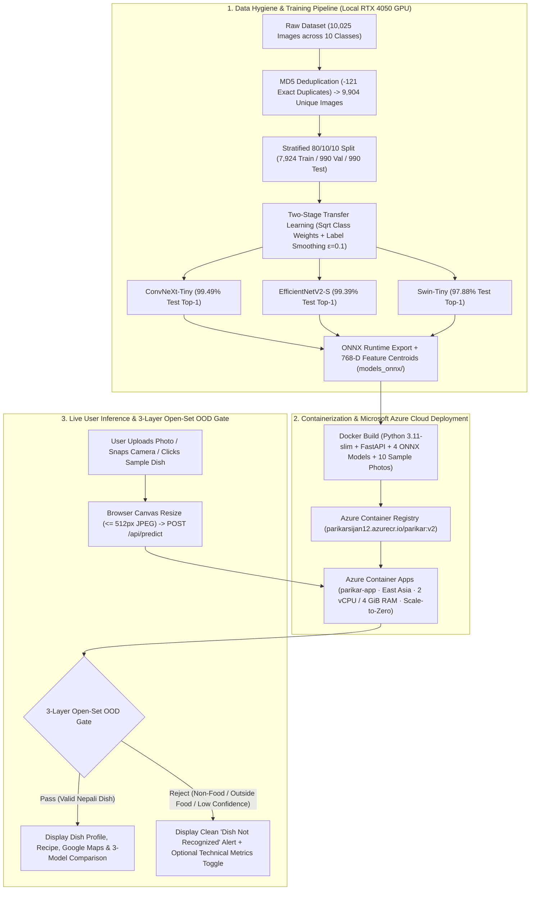
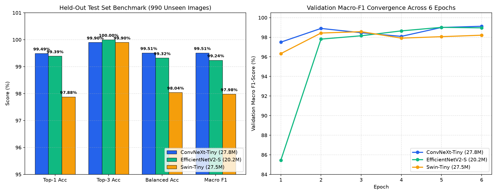

# Parikar 2.0 — Nepali Food Classifier

**Created & Engineered by Sijan Pandey**

🌐 **Live Cloud App (Microsoft Azure Container Apps):** **[https://parikar-app.livelystone-a6619db0.eastasia.azurecontainerapps.io/](https://parikar-app.livelystone-a6619db0.eastasia.azurecontainerapps.io/)**

End-to-end computer vision pipeline and real-time multi-model studio for classifying **10 traditional and street Nepali dishes & beverages** (`momo`, `dalbhat`, `selroti`, `yomari`, `chatpate`, `jeri`, `samosa`, `panipuri`, `pakauda`, and `chiya`), built for cloud deployment on **Microsoft Azure for Students** + **GitHub**.

---

## End-to-End System & Cloud Deployment Workflow

---

## Dataset Audit & Leak-Free Split (`splits/`)
Before training any model, we ran an automated integrity and cryptographic deduplication pass (`src/prepare_dataset.py`) across all `10,025` raw files:
- **Total Scanned:** `10,025` images
- **Corrupted Files:** `0`
- **Exact Byte-for-Byte (MD5) Duplicates Removed:** **`121` duplicate images** (e.g., `chiya/chiya_0051.jpg` == `chiya/chiya_0001.jpg`, `chatpate/000054.jpg` == `chatpate/000043.jpg`) removed *before* splitting to guarantee zero train-to-test data leakage.
- **Total Unique Verified Images:** **`9,904`** (`7,924` Train / `990` Val / `990` Test — 80/10/10 stratified split)

| Class | Unique Images | Train (80%) | Val (10%) | Test (10%) | Inverse Weight | Smoothed Weight ($\sqrt{\bar{N}/N_c}$) |
| :--- | ---: | ---: | ---: | ---: | ---: | ---: |
| `momo` | 2,219 | 1,775 | 222 | 222 | 0.4464 | **0.6681** |
| `samosa` | 1,287 | 1,030 | 129 | 128 | 0.7693 | **0.8771** |
| `jeri` | 1,219 | 975 | 122 | 122 | 0.8127 | **0.9015** |
| `chiya` | 1,093 | 874 | 109 | 110 | 0.9066 | **0.9522** |
| `selroti` | 1,047 | 838 | 105 | 104 | 0.9456 | **0.9724** |
| `panipuri` | 863 | 690 | 86 | 87 | 1.1484 | **1.0716** |
| `pakauda` | 800 | 640 | 80 | 80 | 1.2381 | **1.1127** |
| `dalbhat` | 612 | 490 | 61 | 61 | 1.6171 | **1.2717** |
| `yomari` | 422 | 338 | 42 | 42 | 2.3444 | **1.5311** |
| `chatpate` | 342 | 274 | 34 | 34 | 2.8920 | **1.7006** |

---

## Modeling & Imbalance Engineering
- **Environment:** Anaconda `hydro` (`Python 3.11.15`, `PyTorch 2.13.0+cu130`, `Torchvision 0.28.0+cu130` on **NVIDIA GeForce RTX 4050 Laptop GPU 6GB**).
- **Imbalance Handling (`6.49:1` unique ratio):** On-the-fly `WeightedRandomSampler` using **Smoothed Square-Root Weights** ($\sqrt{\bar{N}/N_c}$) paired with `CrossEntropyLoss(label_smoothing=0.1)`.
- **Food-Safe Augmentation:** Preserves critical food color cues while applying `RandomResizedCrop`, horizontal flips, `±15°` rotations, mild brightness/contrast jitter, and `RandomErasing`.
- **Two-Stage Transfer Learning (`src/train_and_eval.py`):**
  1. **Phase 1 (Head Warmup):** Freezes the ImageNet backbone and warms up the 10-class classifier head (`lr=1e-3`).
  2. **Phase 2 (Full Fine-Tuning):** Unfreezes the backbone with differential learning rates (`1.5e-4` backbone, `5e-4` head), Cosine Annealing scheduler, and `bfloat16` mixed precision.
- **Benchmarked Models:** `ConvNeXt-Tiny`, `EfficientNetV2-S`, and `Swin-Tiny`.

---

## Model Benchmark Results (Held-Out Test Set — `990` Unseen Images)

| Model Architecture | Params | Val Top-1 | Val Macro-F1 | Test Top-1 Acc | Test Top-3 Acc | Test Balanced Acc | Test Macro-F1 | `chatpate` F1 (Minority) | Latency |
| :--- | ---: | ---: | ---: | ---: | ---: | ---: | ---: | ---: | ---: |
| **`ConvNeXt-Tiny`** | 27.8M | **99.29%** | **99.12%** | **99.49%** | 99.90% | **99.51%** | **99.51%** | **100.00%** | 19.48 ms |
| **`EfficientNetV2-S`** | **20.2M** | 98.99% | 99.01% | 99.39% | **100.00%** | 99.32% | 99.24% | 98.55% | 18.70 ms |
| **`Swin-Tiny`** | 27.5M | 98.69% | 98.57% | 97.88% | 99.90% | 98.04% | 97.98% | **100.00%** | **15.47 ms** |

---

## 3-Layer Open-Set / Out-of-Distribution (OOD) Gate & Azure Hosting
- **3-Layer Open-Set Rejection (`backend/app.py`):**
  1. **Layer 1 — Semantic Domain Verifier (`semantic_gate.onnx`):** Uses a `MobileNetV3-Small` ONNX model calibrated on a 120-class culinary mask to filter out non-food objects (faces, laptops, rooms, animals) and outside Western foods (`pizza`, `cheeseburger`, `hotdog`, `ice cream`, fruits).
  2. **Layer 2 — 768-D Feature Centroid Cosine Similarity (`convnext_centroids.npy`):** Verifies that the image's 768-dimensional penultimate feature vector in `ConvNeXt-Tiny` aligns with the learned class prototype ($\cos \ge 0.85$).
  3. **Layer 3 — Multi-Model Softmax & Consensus Calibration:** Combines Top-1 Confidence ($\ge 78\%$), Top-1/Top-2 Margin ($\ge 60\%$), Normalized Shannon Entropy ($\le 0.36$), Pre-Softmax Max Logit ($\ge 3.35$), and 3-Architecture (`ConvNeXt-Tiny` + `EfficientNetV2-S` + `Swin-Tiny`) consensus.
- **Cloud Deployment (`Dockerfile` + Azure Container Apps):**
  - Packaged with `.dockerignore` into `parikarsijan12.azurecr.io/parikar:v2` and deployed on **Microsoft Azure Container Apps** (`eastasia`, `2.0 vCPU / 4.0 GiB RAM`, scale-to-zero `--min-replicas 0`) at **[https://parikar-app.livelystone-a6619db0.eastasia.azurecontainerapps.io/](https://parikar-app.livelystone-a6619db0.eastasia.azurecontainerapps.io/)**.

---

## Project Log & Interview Notes
Detailed engineering decisions, trade-offs, and experiment logs are tracked in **[docs/project_log.md](docs/project_log.md)**.
